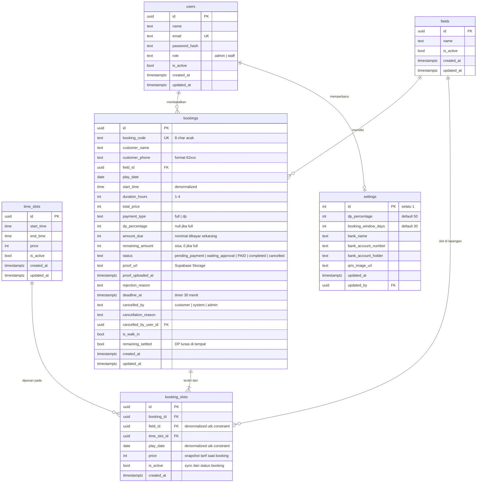

# ERD — Website Pemesanan Online Lapangan Mini Soccer

|                 |                       |
| --------------- | --------------------- |
| Versi           | 1.0                   |
| Tanggal         | 6 November 2026       |
| Database        | PostgreSQL (Supabase) |
| Dokumen terkait | PRD.md                |

---

## 1. Ringkasan

Sistem ini memiliki **6 tabel** yang mendukung seluruh alur bisnis pada PRD:

| Tabel           | Fungsi                                                     |
| --------------- | ---------------------------------------------------------- |
| `users`         | Akun admin & staff                                         |
| `fields`        | Daftar lapangan                                            |
| `time_slots`    | Master slot jam & tarif per jam                            |
| `bookings`      | Pesanan utama                                              |
| `booking_slots` | Relasi booking ↔ slot jam (1 booking = 1–4 slot berurutan) |
| `settings`      | Konfigurasi global (rekening, QRIS, % DP, batas hari)      |

> **Tidak ada** tabel untuk: log WA, refund, riwayat status, promo, atau akun customer — sesuai PRD §3.

---

## 2. Diagram ERD

